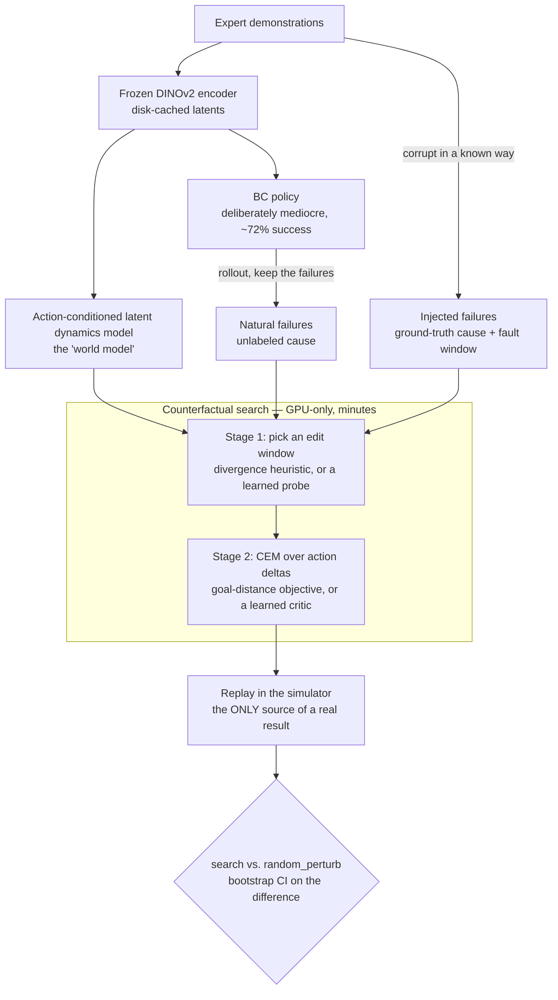

# Counterfactual Action Editing in Latent Action Space

Can a learned world model figure out *the minimal change to a failed robot episode's actions
that would have made it succeed* — and does that edit actually work when you replay it in
simulation?

## TL;DR

**No, not yet — and this repo now says so precisely instead of quietly.**

The world model's latents *do* contain real, verified information about **where** a policy
went wrong (fault localization: AUROC 0.88–0.92, confirmed against a control that scores at
chance). A learned critic *does* carry real signal about **which candidate edit is better**
(ranking accuracy 0.62–0.71, consistently above the 0.50 coin-flip line). But across **eight
independently replayed, non-oracle search configurations** — every combination of window-finding
strategy and edit-selection strategy this project built — none of them produce an edit that
beats a same-sized *random* edit, with statistical significance, at the simulator. The only
configuration that wins requires already knowing the true fault window, which no deployed method
has.

That combination — real, measurable signal about the problem, no demonstrated way to turn it
into a *fix* — is the actual finding. Full evidence, every run ID, every rejected alternative:
[`PROGRESS.md`](PROGRESS.md) — search it for *"Synthesis: C1 is a negative result"*
(2026-08-11), the entry that pulls the full session's evidence into one place.

## What this project does

Given a failed robot manipulation episode, search a learned world model for the **minimal edit
to the executed action sequence that would have succeeded**, then validate that edit by
replaying it in simulation from the byte-identical initial state. The design compares two
things:

1. **C1 (the load-bearing claim).** Edits found by searching a world model replay successfully
   in simulation far more often than edits of equal size chosen at random. If this fails, the
   rest is moot — the world model isn't contributing anything a coin flip couldn't.
2. **C2 (the interesting question, never reached).** Whether searching in a *learned latent
   action space* finds better edits than searching in raw 7-DOF robot-action space. This
   requires C1 to hold first; it never got built.

Every reported success number comes from actually executing the edited actions in the LIBERO /
MuJoCo simulator — never from how close the model's internal prediction is to a goal. That
distinction is enforced throughout the codebase (see [Architecture](#architecture) below)
precisely because it's the easiest way for a project like this to fool itself.

## Architecture



| Stage | Where | What it does |
|---|---|---|
| Encoder | `cfe/encoders/` | Frozen DINOv2-base → patch-token latents, disk-cached. Never trains. |
| BC policy | `cfe/policy/` | Small MLP head on pooled latents + proprioception. Kept deliberately weak — its job is to *produce* failures, not avoid them. |
| Dynamics model | `cfe/dynamics/` | Small transformer: `(latent context, action chunk) → predicted future latents`. This is "the world model" everything else queries. |
| Failure set | `cfe/data/` | **Natural** = real policy rollouts that failed (no ground-truth cause). **Injected** = a successful demo corrupted one of four known ways (`grasp_offset`, `mistimed_close`, `early_release`, `wrong_target`), kept only if it *actually* fails on replay. |
| Search | `cfe/search/` | Two stages, deliberately separate: **stage 1** ranks candidate edit windows without touching the simulator; **stage 2** runs CEM (cross-entropy method) over action deltas within the chosen window. Both stages are GPU-only and re-runnable in minutes. |
| Eval | `cfe/eval/` | **Frozen after Phase 2.** Metrics and the replay protocol — the only code allowed to produce a number that gets reported. A pre-commit hook blocks edits to this directory. |

**The one rule that makes every number in this repo trustworthy:** a latent-space distance is a
*search objective*, never a *result*. The only thing that counts as a result is what happens
when the edited actions are actually executed in the simulator (`scripts/run_replay.py`). This
is enforced by convention, by a hook, and by keeping `cfe/eval/` isolated from everything that
proposes edits.

## The result, in detail

**The claim (SPEC.md, C1):** does `search` beat `random_perturb` (same edit budget, matched
magnitude) with a 95% bootstrap CI excluding zero — *without* using the ground-truth fault
window a deployed method would never have?

| Window source | Edit-selection strategy | RSR search | RSR random | 95% CI | Beats random? |
|---|---|---|---|---|---|
| Heuristic (divergence-based) | goal-distance objective | 0.00–0.10 | ~0.00–0.10 | includes 0 | no |
| Heuristic | learned critic as objective | 0.02–0.05 | 0.02–0.04 | includes 0 | no |
| Learned probe (56 episodes) | goal-distance objective | 0.21–0.30 | 0.32–0.36 | includes 0 | no |
| Learned probe (56 episodes) | learned critic as objective | 0.32–0.34 | 0.32–0.36 | includes 0 | no |
| Learned probe (56 episodes) | critic re-ranks CEM's own candidates | 0.36 | 0.32 | includes 0 | no |
| Learned probe (160 episodes) | critic re-ranks CEM's own candidates | 0.30 | 0.27 | includes 0 | no |
| Learned probe + 4-model ensemble | critic re-ranks | 0.30 | 0.27 | includes 0 | no |
| **Top-3 candidate windows** | critic re-ranks over all of them | 0.375 | 0.393 | includes 0 | no |
| **Ground truth (oracle-only)** | critic re-ranks CEM's own candidates | **0.643** | 0.38–0.39 | **excludes 0** | **yes** |

Eight configurations without oracle information; zero beat random with significance. The one
configuration that *does* work needs the injected failure's own ground-truth fault window —
information that doesn't exist for a real, undiagnosed failure. Giving the same critic a much
better (but still imperfect) window closed most of the *absolute* gap to the oracle case but
none of the *relative* gap to `random_perturb`, because a random edit benefits from a better
window exactly as much as a chosen one does. A post-hoc check across every replayed episode
(168 instances, stratified by how good the actual window was) found no threshold effect either —
the best windows this project achieved score no better than the worst.

Full derivation, every run ID, every rejected alternative: [`PROGRESS.md`](PROGRESS.md).

## Repo layout

```
.
├── cfe/                  # the "counterfactual editing" package
│   ├── encoders/         # frozen DINOv2 wrapper + disk cache
│   ├── dynamics/         # the world model
│   ├── policy/           # the BC policy (failure generator, not a contribution)
│   ├── data/             # demo loading, failure-set construction, injections
│   ├── search/           # two-stage counterfactual search, incl. the learned critic
│   └── eval/             # FROZEN — metrics + replay protocol, the only source of results
├── scripts/              # one entrypoint per pipeline stage + every diagnostic
├── configs/              # one YAML per component; every run snapshots its config
├── tests/                # correctness tests — see SPEC.md §8 for what's covered and why
└── results/              # gitignored except results/figures/ — see "Getting started" below
```

## Getting started

```bash
bash scripts/setup_env.sh  # bootstraps the pinned venv, then runs the G0 gate itself
make test       # fast unit tests, no simulator
make test-slow  # includes simulator-dependent tests
make lint       # ruff check + format
```

The venv lives outside the repo (`~/.venvs/failure-detection-WM` by default) — the `make`
targets assume it already exists, which is what `setup_env.sh` is for. Three version pins
matter more than usual here and are easy to break with a routine
`pip install -U`: **`mujoco<=3.3.7`**, **`robosuite==1.4.x`**, and LIBERO itself blocks on an
interactive prompt the first time it's imported if `~/.libero/config.yaml` doesn't exist yet.
See [`CLAUDE.md`](CLAUDE.md) if any of the setup scripts misbehave — it documents the specific
traps this project already hit so you don't have to rediscover them.

`results/`, `data/`, and the encoding cache are gitignored (they're large and reproducible) —
a fresh clone has the code but not the ~10 GB of cached latents or the trained checkpoints. The
pipeline stages, run in order, are:

```bash
scripts/collect_demos.py        # → BC policy training data
scripts/train_policy.py         # → the (deliberately weak) failure-generating policy
scripts/train_dynamics.py       # → the world model
scripts/build_failure_set.py    # → natural + injected failures, kept only if they actually fail
scripts/run_search.py           # → GPU: proposes an edit for every episode × arm × budget
scripts/run_replay.py           # → CPU simulation: the ONLY source of a real result
scripts/verify_g3.py            # → the gate that reads run_replay.py's output
```

Each stage takes `--config configs/<name>.yaml --seed N --run-id <id>` and writes a full config
snapshot alongside its output under `results/runs/<run_id>/` — no result exists without the
config that produced it.

## Documentation map

This project keeps its process documentation because the process is part of the result — every
number here traces back through a specific run ID to a specific config.

| File | What it's for |
|---|---|
| [`SPEC.md`](SPEC.md) | The contract: full design, invariants, and the phase-gate criteria — written and frozen *before* the methods they gate. |
| [`PROGRESS.md`](PROGRESS.md) | The complete, append-only experimental log — every run, every number, every rejected idea, in chronological order. The source of truth behind the summary table above. |
| [`CHANGELOG.md`](CHANGELOG.md) | Every change to a metric, threshold, gate, or the replay protocol, with the reasoning and the rejected alternatives. |
| [`CLAUDE.md`](CLAUDE.md) | Engineering conventions, install pitfalls, and hard-won gotchas — written as onboarding for an AI coding agent ([Claude Code](https://code.claude.com/docs/en/overview) built this project), but equally useful for a human picking this up. |

## Status

| Gate | Result | What it checks |
|---|---|---|
| G0 | ✅ PASS | Environment: headless render, exact-state reset, a demo loads |
| G1 | ✅ PASS | Encoder + BC policy — 72% success (Wilson 95% CI [0.583, 0.825]), failure-mode breakdown reported |
| G2 | ✅ PASS | World model beats copy-last-latent *and* an action-ignoring twin at the horizon the search actually uses |
| G3 | ❌ **FAIL** (4/6) | End-to-end: does the search beat `random_perturb`? **No.** This is C1, closed as a negative result. |
| G4–G6 | not reached | Full-scale C1 table, the latent-action arm (C2), and final figures all depend on G3 passing. |

## Scope

Explicitly out of scope, and treated as a signal of scope drift if proposed: a recovery policy,
a VLM/language explanation layer, real hardware, photorealistic generation, a web UI, multi-GPU
training, or hyperparameter search infrastructure. See `SPEC.md` §9.

What the negative result does *not* cover: a second task suite (`libero_object` task 1/2 was
queued but never completed), and generalization to an injected failure *cause* the method has
zero training examples of (every result here is leave-one-*episode*-out, never
leave-one-*cause*-out). Neither is ruled out — both are untested.

## License

[MIT](LICENSE). Third-party components (LIBERO, robosuite, MuJoCo, DINOv2) keep their own
licenses.
